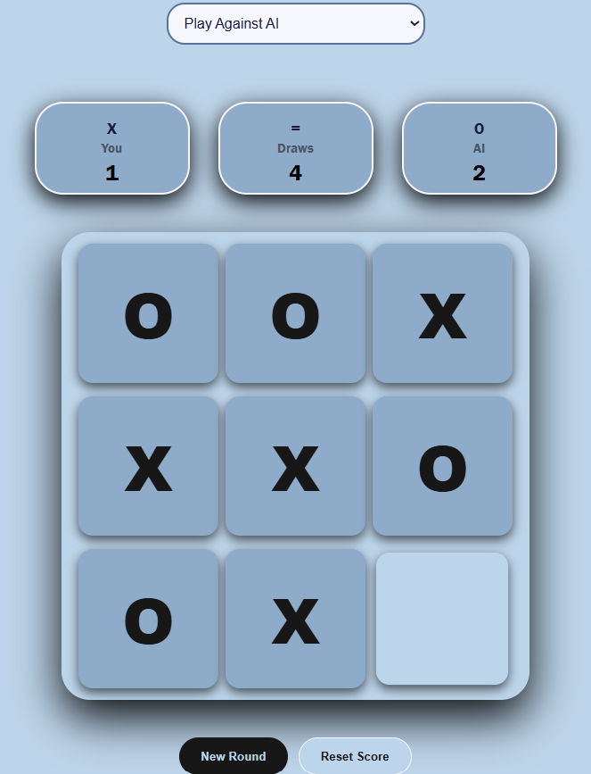

# Tic Tac Toe — Interactive Game with AI

An interactive Tic Tac Toe game built using HTML, CSS, and JavaScript. It features two-player gameplay, an AI opponent powered by the Minimax algorithm, and a score tracker that saves results between rounds.

## Play the Game

**[Click here to play Tic Tac Toe] (https://tanishab07.github.io/tic-tac-toe/)**

## Project Preview



## Features

- **Two-Player Mode:** Play against another person on the same device.
- **AI Opponent:** Challenge the computer using the Minimax algorithm.
- **Score Tracking:** Keep track of wins and draws across multiple rounds.
- **Saved Scores:** Uses browser Local Storage to preserve scores between page visits.
- **Separate Result Pages:** Displays dedicated pages for wins and draws.
- **New Round:** Start another round without resetting your scores.
- **Reset Score:** Clear saved scores with a confirmation prompt.
- **Clean Interface:** A blue-and-white design with simple game controls.

## Technologies Used

- HTML5
- CSS3
- JavaScript
- Minimax Algorithm
- Browser Local Storage

## Run Locally

1. Download or clone this repository.
2. Open the project folder.
3. Open `index.html` in your web browser.
4. Choose a game mode and start playing.

No additional packages are required.

## Project Structure

```text
tic-tac-toe/
├── index.html
├── style.css
├── script.js
├── winner.html
├── winner2.html
├── draw.html
├── screenshot.png
└── README.md
```

## What I Learned

- Writing game logic with JavaScript.
- Working with DOM elements and event listeners.
- Implementing an AI opponent with the Minimax algorithm.
- Saving and retrieving data using Local Storage.
- Managing navigation between multiple HTML pages.
- Debugging and improving an interactive application.

## Author

**Tanisha Bhardwaj**

BCA Student | Aspiring Full Stack Developer

This project is part of my journey of learning programming and building practical projects.

## License

This project is available for learning and personal use. See the `LICENSE` file if a formal license has been added.

